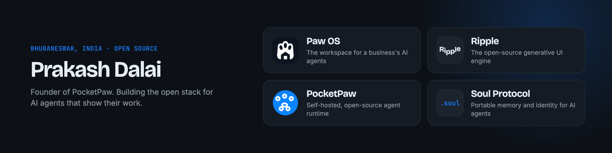

I'm building PocketPaw from Bhubaneswar, India. Everything below is open source.

| Project | What it is | Links |
|---|---|---|
| **Paw OS** | The workspace for a business's AI agents | [os.pocketpaw.xyz](https://os.pocketpaw.xyz) |
| **Ripple** | The open-source generative UI engine. A model writes a JSON spec, Ripple renders it as a live interface while it streams | [ripple.pocketpaw.xyz](https://ripple.pocketpaw.xyz) · [repo](https://github.com/qbtrix/ripple-iui) |
| **PocketPaw** | Self-hosted, open-source agent runtime | [pocketpaw.xyz](https://pocketpaw.xyz) · [repo](https://github.com/pocketpaw/pocketpaw) |
| **Soul Protocol** | Portable memory and identity for AI agents | [repo](https://github.com/qbtrix/soul-protocol) |

Find me on [X](https://x.com/prakashd88).
